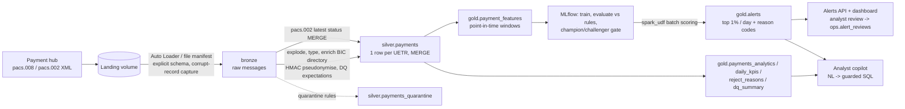

# Payments Lakehouse Accelerator

**An FDE-style reference engagement:** a German bank wants to move monitoring of its outgoing SEPA credit transfers (ISO 20022 `pacs.008` / `pacs.002`) onto a lakehouse and replace its threshold rules with something its fraud team can trust. This repository is the delivered accelerator: a medallion pipeline on Spark + Delta, data-quality expectations, privacy by design, a fraud/mule model tracked in MLflow and evaluated the way analysts work, a guarded natural-language copilot, an alerts API, and a Databricks Asset Bundle to deploy it.

> All data is synthetic and generated by `paylake generate`; no real customer data is involved. The metrics below come from that synthetic dataset, so they show the method, not real-world fraud performance.



## Results (synthetic run: 30 days, 4,000 customers, 125,754 payments)

Full pipeline in two incremental passes (days 1-24, then 25-30), local Spark on a 2-core box: **151 s end to end**, including data generation.

| Area | What was measured | Result |
|---|---|---|
| Ingestion | 273 pacs.008 files incl. 3 re-sent by the hub and 1 truncated upload | a repeat run picks up **0 files** (tested); truncated file captured as 1 corrupt record; **1,499 duplicate UETRs** absorbed by MERGE |
| Data quality | 9 expectation rules plus XML-integrity and duplicate checks over 127,254 evaluated transactions | **180 quarantined** (non-positive amounts, implausible settlement dates, missing UETR); 499 bad creditor IBANs flagged; the 488 with a status report so far all came back **RJCT AC01** from pacs.002 |
| Status | 125,575 silver payments | 123,479 ACSC, 1,097 RJCT (AC01 / AM04 / AM05), 999 still pending on the newest files |
| Fraud model | time-based test set: last 30% of days, 38,606 payments, 380 confirmed fraud | **PR-AUC 0.94**; at a 1% daily alert budget: **87% precision, 88% recall** |
| Model vs rules | same alert volume as the incumbent rule set (337 alerts) | rules: 27% precision / 24% recall; model: **93% precision / 83% recall** |
| By typology (recall at budget) | APP scam / mule fan-in / structuring | model **82% / 88% / 100%** vs rules 36% / 8% / 52% |
| Copilot | 16 reference questions + 4 must-refuse questions | all reference SQL passes the guardrails and executes; 13 adversarial SQL cases blocked in tests |
| Tests | `pytest` | **42 tests**, local Spark + Delta, no workspace needed |

One finding worth bringing to the customer: **layering the model on top of the existing rules was worse than replacing them.** At the same 1% budget, "rules first, model fills the rest" reached 36% recall versus 88% for the model alone, because the rules spend most of the analysts' capacity on low-precision alerts. The evaluation reports this hybrid variant on every run so the decision rests on numbers, not opinion.

## What is in the box

| Path | Purpose |
|---|---|
| `src/paylake/datagen.py` | Seeded ISO 20022 traffic: customer behaviour, popular merchants, legit look-alikes (one-off large payments, night-shift workers), three fraud typologies, DQ defects, re-sent and truncated files, and confirmed cases as a separate feed |
| `src/paylake/bronze.py` | Incremental, exactly-once file pickup with explicit XML schemas (`DECIMAL(18,2)` amounts) and corrupt-record capture; Auto Loader reader for Databricks |
| `src/paylake/expectations.py` | DQ rules defined once; run in the job **and** exported as `@dlt.expect_all` / `expect_all_or_drop` for Lakeflow Declarative Pipelines |
| `src/paylake/silver.py` | Flatten, enrich (broadcast BIC directory), pseudonymise, quarantine, MERGE on UETR, apply latest pacs.002 status (order-independent) |
| `src/paylake/gold.py` | Point-in-time window features (velocity, new payee, amount z-score vs. own history, payee fan-in, creditor age, structuring), PII-free fact tables and KPIs |
| `src/paylake/ml.py` | Time-split training, alert-budget evaluation, rules and hybrid baselines, per-typology recall, MLflow logging + registry, champion/challenger promotion gate, Spark batch scoring via `mlflow.pyfunc.spark_udf`, reason codes |
| `src/paylake/copilot/` | NL->SQL copilot (Claude or any LLM client); `sqlglot` guardrails (single read-only SELECT, allowlisted gold tables, no PII columns, denylisted functions, forced LIMIT); execution-match eval harness |
| `src/paylake/app/` | FastAPI alerts API + dashboard; analyst decisions are written to `ops.alert_reviews` as labels for the next training run |
| `src/paylake/lake.py` | One `Lake` interface: Unity Catalog / native Delta on Databricks, delta-rs Delta tables locally |
| `databricks.yml`, `resources/` | Asset Bundle: wheel artifact, UC schemas + landing volume, 5-task serverless job, dev/prod targets |
| `pipelines/lakeflow_silver.py` | Declarative (Lakeflow) version of bronze->silver using the same expectation registry |
| `governance/unity_catalog.sql` | Grants by layer, column masks on IBANs/names, PII tags, legal-hold row filter |
| `.github/workflows/ci.yml` | Tests, an end-to-end smoke run with a model quality gate, and `bundle validate/deploy` when workspace secrets exist |
| `docs/` | Engagement brief, architecture decisions, operations runbook |

## Run it locally

Requires Python 3.10+ and Java 17+.

```bash
pip install -e ".[dev]"
paylake generate --days 30 --customers 4000        # writes ./landing
paylake run --as-of 2026-09-24 --skip-ml           # first incremental pass
paylake run                                        # remaining days + train + score
paylake serve                                      # http://localhost:8000 dashboard and API
pytest
```

Copilot (needs an Anthropic API key; any LLM client with `complete(system, user)` can be injected instead):

```bash
export ANTHROPIC_API_KEY=...
paylake ask "Which 3 creditor countries had the highest reject rate last week?"
paylake eval-copilot                               # execution accuracy + refusal accuracy
```

## Deploy to Databricks

```bash
databricks secrets create-scope paylake
databricks secrets put-secret paylake hmac_key
databricks bundle validate -t dev
databricks bundle deploy -t dev
# upload landing files to /Volumes/payments_dev/bronze/landing/{pacs008,pacs002,cases}
databricks bundle run payments_lakehouse -t dev
```

Then run `governance/unity_catalog.sql` with `catalog=payments_dev`.

## Scope and honesty notes

- **Local CI runs the full pipeline** on open-source Spark 4 with real Delta tables written through delta-rs, because the build sandbox had no Maven access for the Delta Spark jars. The Databricks code path (`DatabricksLake`, Auto Loader reader, Lakeflow file, bundle, UC SQL) is written against the documented APIs but **has not yet been run on a live workspace**.
- Data and labels are synthetic; fraud is far more frequent here (about 0.7%) than in real outgoing SCT traffic, and the typologies were designed to be learnable. The value is the method: time split, alert-budget metrics, equal-volume comparison with rules, per-typology recall and a promotion gate.
- The copilot's guardrails and eval harness are tested with stub models; the live model eval runs only when an API key is set.

## Author

Manoj Kumar Prakash: 14 years in banking and payments QA/engineering (Wells Fargo, JPMorgan Chase, Standard Chartered, ANZ), now building AI and data systems. [LinkedIn](https://linkedin.com/in/manoj-kumar-prakash-52b7a01b6) · [GitHub](https://github.com/manojrevenkar12-web)
